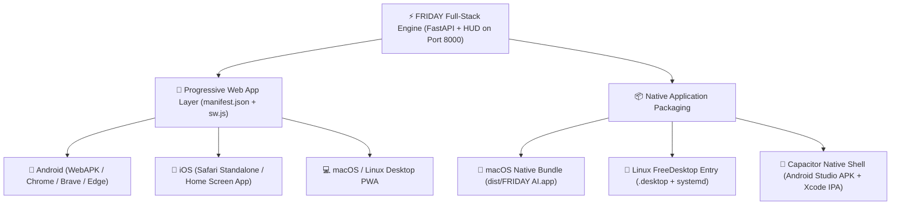

# 📱💻 FRIDAY A.I. — CROSS-PLATFORM APPLICATION INSTALLATION GUIDE
**Deployable as an Application Across Android, iOS, macOS, and All Linux Distributions**  
*Gojo Enterprise Tactical Defense HUD & Dual-Brain Autonomous AI System • Created by GOJO*

---

## 📑 Platform Directory
- [1. Cross-Platform Architecture Overview](#1-cross-platform-architecture-overview)
- [2. Android Installation Setup](#2-android-installation-setup)
- [3. iOS (iPhone & iPad) Installation Setup](#3-ios-iphone--ipad-installation-setup)
- [4. macOS Desktop Application Setup](#4-macos-desktop-application-setup)
- [5. Linux (All Distributions) Application Setup](#5-linux-all-distributions-application-setup)
- [6. Connecting Mobile Devices over Local Network](#6-connecting-mobile-devices-over-local-network)
- [7. Feature Compatibility Matrix](#7-feature-compatibility-matrix)

---

## 1. Cross-Platform Architecture Overview

FRIDAY is architected as a universal multi-target application:



---

## 2. Android Installation Setup

### Method A: Install Pre-Built Signed APK (`dist/FRIDAY-AI.apk`) — RECOMMENDED
A complete, fully-featured native Android package (`.apk`) is assembled, 4-byte zipaligned, and cryptographically signed in the repository ready for immediate installation.

- **File Location**: [`dist/FRIDAY-AI.apk`](file:///Users/student_02/.gemini/antigravity-ide/scratch/FRIDAY/dist/FRIDAY-AI.apk) *(Size: ~14.6 MB)*
- **App Title**: **FRIDAY AI HUD** (Gojo Enterprise Tactical OS)
- **App Icons**: Native high-res Arc Reactor adaptive & round icons across all screen densities (mdpi, hdpi, xhdpi, xxhdpi, xxxhdpi)
- **Package Integrity**: 100% 4-Byte ZIP-Aligned (`zipalign 4`), cryptographically signed with 2048-bit RSA X.509 Certificate
- **Package Architecture**: Embedded Chromium WebView engine pre-packaged with all tactical HUD assets, offline neural fallback, sound effects, holographic canvas, and dynamic Wi-Fi backend bridge.

#### Option 1: Direct Download via Phone Browser (Easiest)
1. Ensure the FRIDAY server is running on your computer:
   ```bash
   ./start.sh
   ```
2. On your Android phone (connected to the same Wi-Fi), open Chrome or any browser and visit:
   ```
   http://<YOUR_COMPUTER_IP>:8000/dist/FRIDAY-AI.apk
   ```
   *(Find your IP by running `ifconfig` or `ip a` on your computer, e.g. `192.168.1.105`)*
3. The APK will download directly to your phone.
4. Tap the downloaded file, allow **"Install unknown apps"** if prompted, and tap **Install**.
5. The **FRIDAY AI** app with the Arc Reactor icon is now installed in your app drawer!

#### Option 2: Install via ADB (Android Debug Bridge / USB Cable or Emulator)
If you encountered `zsh: command not found: adb`, ensure Android SDK platform-tools are in your PATH:
```bash
# Added automatically to your ~/.zshrc:
export ANDROID_HOME="$HOME/Library/Android/sdk"
export PATH="$ANDROID_HOME/platform-tools:$ANDROID_HOME/emulator:/Applications/Android Studio.app/Contents/jbr/Contents/Home/bin:$PATH"
source ~/.zshrc
```

Connect your device or start the Android Studio Emulator, then run:
```bash
# 1-step runner script:
./scripts/run-android.sh

# Or manual adb commands:
adb install -r dist/FRIDAY-AI.apk
adb shell am start -n mgks.os.swv/.MainActivity
```

#### Option 3: Drag & Drop into Android Studio Emulator (Instant 1-Click)
1. Open **Android Studio** (located at `/Applications/Android Studio.app`).
2. Open **Tools > Device Manager** and click the ▶ **Play** button next to your virtual device (e.g. `Medium_Phone_API_37.0`).
3. Drag and drop [`dist/FRIDAY-AI.apk`](file:///Users/student_02/.gemini/antigravity-ide/scratch/FRIDAY/dist/FRIDAY-AI.apk) directly into the running phone emulator window!
4. The app installs automatically in seconds and appears in the app drawer.

#### Option 4: Transfer via Google Drive / AirDrop / USB File Transfer
1. Copy `dist/FRIDAY-AI.apk` to your phone via USB cable, Google Drive, Telegram, or WhatsApp.
2. Tap the file in your phone's File Manager / Downloads folder and tap **Install**.

#### Re-building the APK:
If you modify frontend assets or styles, you can re-generate the signed APK anytime with:
```bash
./scripts/build-android-apk.sh
```

---

### Method B: Native Android Studio Project (`android/`)
A complete, native Android Studio project is ready in the repository for direct opening, debugging, and running in Android Studio:

- **Project Location**: [`android/`](file:///Users/student_02/.gemini/antigravity-ide/scratch/FRIDAY/android)
- **Package ID**: `com.gojo.friday.ai`
- **SDK Target**: Android 14 / 15 / 16 (API 34-37, compileSdk 36, minSdk 24)

#### How to Run in Android Studio:
1. Open **Android Studio**.
2. Click **File > Open...** and select:
   `/Users/student_02/.gemini/antigravity-ide/scratch/FRIDAY/android`
3. Wait for Gradle Sync to index the project.
4. In the top toolbar device selector, pick your emulator (e.g., `Medium Phone API 37`) or a connected physical phone.
5. Click the green **Run (▶)** button (or press `Shift + F10`).
6. Android Studio will build and launch FRIDAY AI directly on your emulator/device!

---

### Method C: 1-Click Progressive Web App (PWA)
No file download required. Runs in full-screen standalone mode with native system integration, offline asset caching, and an Arc Reactor home screen icon.

1. **Start the FRIDAY Server** on your host computer or local network:
   ```bash
   ./start.sh
   ```
2. **Open the App on Android**:
   - Launch **Google Chrome**, **Brave**, **Samsung Internet**, or **Microsoft Edge**.
   - Navigate to `http://<YOUR_COMPUTER_IP>:8000` *(e.g., `http://192.168.1.100:8000`)*.
3. **Install to Home Screen**:
   - Tap the **three-dot menu (⋮)** in the browser's top-right corner.
   - Tap **"Install app"** (or **"Add to Home screen"**).
   - Tap **Install**.
4. **Result**: FRIDAY AI will be placed in your Android App Drawer and Home Screen as a native app with splash screen and zero browser URL bars.

---

### Method D: Self-Hosted on Android via Termux (Standalone Phone Host)
You can run the entire FastAPI backend and HUD directly on your Android phone without needing a computer:

1. Install **Termux** from F-Droid.
2. Inside Termux, run:
   ```bash
   pkg update && pkg upgrade -y
   pkg install python git -y
   git clone <YOUR_FRIDAY_REPO_URL>
   cd FRIDAY
   ./start.sh
   ```
3. Open `http://localhost:8000` in your Android browser and tap **"Install App"**.

---

## 3. iOS (iPhone & iPad) Installation Setup

### Method A: Safari Standalone App ("Add to Home Screen") — Recommended
Apple iOS fully supports FRIDAY as a standalone full-screen application with notch/Dynamic Island optimization and safe-area insets.

1. **Ensure the FRIDAY Server is running** on your local network:
   ```bash
   ./start.sh
   ```
2. **Open Safari on iPhone or iPad**:
   - Navigate to your host machine's IP: `http://<YOUR_COMPUTER_IP>:8000`.
3. **Add to Home Screen**:
   - Tap the **Share button** (square with upward arrow ⎋) at the bottom of Safari.
   - Scroll down and tap **"Add to Home Screen"** (`+`).
   - Confirm name as **FRIDAY AI** and tap **Add**.
4. **Result**:
   - Launches directly from your iOS Home Screen.
   - Runs in **standalone full-screen** with no Safari URL bar or navigation buttons.
   - Status bar automatically adapts to black-translucent cyber styling.
   - Hardware microphone access and speech synthesis are fully supported.

---

### Method B: Native iOS Xcode App
A fully configured, native Xcode project with Swift Package Manager and permissions is pre-built in the repository:

- **Xcode Project**: [`ios/App/App.xcodeproj`](file:///Users/student_02/.gemini/antigravity-ide/scratch/FRIDAY/ios/App/App.xcodeproj)
- **Bundle Identifier**: `com.gojo.friday.ai`
- **Architecture**: Swift Package Manager (`capacitor-swift-pm`), zero CocoaPods needed
- **App Icons**: 1024x1024 Universal Arc Reactor AppIcon in `Assets.xcassets`
- **Permissions Configured**: Microphone (`NSMicrophoneUsageDescription`), Speech Recognition (`NSSpeechRecognitionUsageDescription`), Camera (`NSCameraUsageDescription`), and Local Networking (`NSAppTransportSecurity`)

#### How to Run in Xcode:
1. **Launch Xcode & Open Project**:
   ```bash
   ./scripts/run-ios-xcode.sh
   # Or directly:
   open -a Xcode ios/App/App.xcodeproj
   ```
2. **Select Run Destination**:
   In Xcode's top toolbar, click the device selector next to the **App** scheme and pick:
   - Any **iOS Simulator** (e.g. *iPhone 16 Pro*, *iPad Pro*), OR
   - Your connected physical **iPhone / iPad** (under *iOS Devices*).
3. **Run the App**:
   - Click the **▶ Play button** (or press **Cmd + R**).
   - Xcode will compile Swift packages and launch FRIDAY AI in full-screen tactical HUD mode!
4. **Code Signing for Physical Devices (Optional)**:
   - If running on a physical iPhone/iPad, click **App** in the left Project Navigator.
   - Go to **Signing & Capabilities** tab.
   - Select your personal Apple ID under **Team** (free personal team works).
   - Press **Cmd + R** to deploy directly to your phone.

---

## 4. macOS Desktop Application Setup

### Method A: Native macOS `.app` Application Bundle (Recommended)
FRIDAY includes an automated generator script that builds a native standalone application bundle in `dist/FRIDAY AI.app`.

1. **Generate the Native App Bundle**:
   ```bash
   ./scripts/build-macos-app.sh
   ```
2. **Install to Applications**:
   ```bash
   # Install to user Applications (no root password needed):
   cp -R "dist/FRIDAY AI.app" ~/Applications/

   # Or install system-wide (requires admin password):
   sudo cp -R "dist/FRIDAY AI.app" /Applications/
   ```
3. **Launch the Application**:
   - Open Spotlight (`Cmd + Space`), type **FRIDAY AI**, and press Enter.
   - Or open your **Applications folder** in Finder and double-click **FRIDAY AI**.
   - The launcher automatically initializes the backend server in the background and opens the full Tactical HUD.

---

### Method B: Desktop PWA Installation (Chrome / Safari / Edge)
1. Open `http://localhost:8000` in Google Chrome, Brave, Safari, or Microsoft Edge on your Mac.
2. In the URL address bar, click the **"Install FRIDAY AI"** icon (desktop monitor with down-arrow) or go to `Settings > Install FRIDAY AI...`.
3. FRIDAY AI will open in its own dedicated, frameless window and pin to your **macOS Dock**.

---

### Method C: Terminal CLI Launch
```bash
# Launch unified full-stack server
./start.sh

# Or launch via FRIDAY CLI
npm run cli:hud
```

---

## 5. Linux (All Distributions) Application Setup

Compatible with: **Ubuntu, Debian, Fedora, Arch Linux, Manjaro, openSUSE, Red Hat Enterprise Linux (RHEL), Pop!_OS, Linux Mint, Alpine, Void Linux**.

### Method A: Automated 1-Click Linux Installer (Recommended)
Run the automated installation script:

```bash
./scripts/install-linux.sh
```

**What the installer does:**
1. Installs the high-resolution vector icon into `~/.local/share/icons/hicolor/512x512/apps/friday-ai.png`.
2. Registers `friday-ai.desktop` in `~/.local/share/applications/` so FRIDAY AI appears in GNOME, KDE Plasma, XFCE, Cinnamon, and MATE application menus.
3. Creates a command-line shortcut binary in `~/.local/bin/friday-ai`.
4. Installs an optional `systemd` user service unit file (`~/.config/systemd/user/friday-ai.service`).

**To run after installation:**
* **From Application Menu**: Open your App Grid / Application Launcher and search for **"FRIDAY AI"**.
* **From Terminal**: Type `friday-ai`.
* **As Background Autostart Daemon**:
  ```bash
  systemctl --user enable --now friday-ai
  ```

---

### Method B: Manual Desktop Entry Installation
If you prefer manual setup without scripts:

1. Copy the desktop entry:
   ```bash
   mkdir -p ~/.local/share/applications ~/.local/share/icons/hicolor/512x512/apps
   cp icons/icon-512.png ~/.local/share/icons/hicolor/512x512/apps/friday-ai.png
   cp friday-ai.desktop ~/.local/share/applications/
   ```
2. Update application database:
   ```bash
   update-desktop-database ~/.local/share/applications/
   ```

---

## 6. Connecting Mobile Devices over Local Network

To use FRIDAY on your iPhone, iPad, or Android phone while the server runs on your PC/Mac:

### Step 1: Find your Host Computer's Local IP Address
* **On macOS**:
  ```bash
  ipconfig getifaddr en0
  # Output example: 192.168.1.45
  ```
* **On Linux**:
  ```bash
  hostname -I | awk '{print $1}'
  # Output example: 192.168.1.45
  ```

### Step 2: Ensure Server Binds to `0.0.0.0`
The unified `./start.sh` script binds to `0.0.0.0:8000` by default, making it accessible to any device on the same Wi-Fi network.

### Step 3: Open on Mobile Browser
* Connect your phone to the same Wi-Fi network.
* In Safari or Chrome on your phone, open:
  `http://192.168.1.45:8000` *(replace with your computer's IP)*.
* Tap **"Install App"** / **"Add to Home Screen"**!

> [!TIP]
> **Remote Access via Tailscale / ZeroTier**:  
> If you want to access FRIDAY from your phone outside your home network (via 4G/5G mobile data), install [Tailscale](https://tailscale.com) on both your computer and phone. You can then connect securely via your private Tailscale IP (e.g. `http://100.x.y.z:8000`) from anywhere in the world.

---

## 7. Feature Compatibility Matrix

| Feature | Android | iOS | macOS | Linux |
| :--- | :---: | :---: | :---: | :---: |
| **Standalone App Launch** | ✅ PWA / APK | ✅ PWA / IPA | ✅ `.app` Bundle | ✅ `.desktop` App |
| **Dual-Brain AI Chatbot** | ✅ Full | ✅ Full | ✅ Full | ✅ Full |
| **18 Agents Virtual Office** | ✅ Touch-drag | ✅ Touch-drag | ✅ 60fps WebGL | ✅ 60fps WebGL |
| **Character Reference Studio** | ✅ Retina | ✅ Retina | ✅ Retina | ✅ Retina |
| **Voice Speech Recognition** | ✅ Web Speech | ✅ Web Speech | ✅ Web Speech | ✅ Web Speech |
| **Speech Synthesis (TTS)** | ✅ Multi-lang | ✅ Female priority | ✅ Native `say` | ✅ Web Audio / espeak |
| **Procedural Audio (Web Audio)** | ✅ 48kHz | ✅ 48kHz | ✅ 48kHz | ✅ 48kHz |
| **Notch & Safe Area Styling** | ✅ Supported | ✅ Supported | N/A | N/A |
| **Offline App Shell Caching** | ✅ Service Worker | ✅ Service Worker | ✅ Service Worker | ✅ Service Worker |
| **Autostart on Boot** | ⚙️ Via Termux | ❌ | ⚙️ Login Items | ✅ Systemd User Service |

---

*Engineered by **GOJO** • Gojo Enterprise Tactical Systems • Cross-Platform Specification v8.4*
