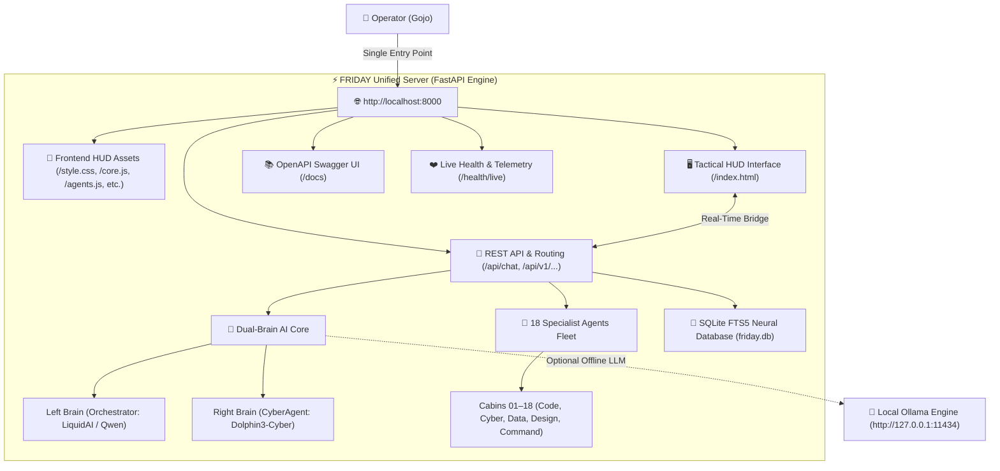

# ⚡ FRIDAY A.I. — UNIFIED FULL-STACK SETUP & OPERATIONAL GUIDE
**Gojo Enterprise Tactical Defense HUD & Dual-Brain Autonomous AI System**  
*Single Full-Stack Port Workflow: `http://localhost:8000` • Created & Engineered by GOJO*

---

## 📑 Table of Contents
1. [Architecture Overview](#1-architecture-overview)
2. [Single-Command Quickstart](#2-single-command-quickstart)
3. [Prerequisites & System Requirements](#3-prerequisites--system-requirements)
4. [Step-by-Step Manual Setup](#4-step-by-step-manual-setup)
5. [Environment Configuration (`.env`)](#5-environment-configuration-env)
6. [Unified System Endpoints & Routing](#6-unified-system-endpoints--routing)
7. [Operating the Chatbot & 18 AI Agent Fleet](#7-operating-the-chatbot--18-ai-agent-fleet)
8. [Live Backend Data Access](#8-live-backend-data-access)
9. [3D Virtual Office & Character Studio References](#9-3d-virtual-office--character-studio-references)
10. [Troubleshooting & FAQ](#10-troubleshooting--faq)

---

## 1. Architecture Overview

FRIDAY uses a **Unified Single-Port Architecture** (`http://localhost:8000`). The FastAPI Central Brain directly serves the Tactical HUD Frontend, static assets, WebSocket channels, and REST APIs simultaneously without requiring separate frontend proxy servers.



### Key Advantages of the Unified Workflow:
* **Single Port Simplicity**: Run one script (`./start.sh`) to start both the AI Backend and Frontend HUD on `http://localhost:8000`.
* **Zero CORS / Same-Origin**: Direct communication between the Chatbot and Backend APIs with zero latency and no cross-origin errors.
* **Instant Hot-Reload**: Changes to frontend assets (`index.html`, `style.css`, `core.js`, `agents.js`) or backend routes update immediately.

---

## 2. Single-Command Quickstart

The fastest way to launch the entire unified application:

```bash
# 1. Navigate to the project root
cd /path/to/FRIDAY

# 2. Run the unified launcher
./start.sh
```

*(Alternatively, if using npm: `npm start` or `npm run dev`)*

That's it! Your browser will be ready to access:
👉 **`http://localhost:8000`**

---

## 3. Prerequisites & System Requirements

| Component | Minimum Requirement | Recommended | Notes |
| :--- | :--- | :--- | :--- |
| **Operating System** | macOS 12+, Ubuntu 20.04+, Windows WSL2 | macOS Sonoma (M-Series / Apple Silicon) | Audio & Speech synthesis optimized for macOS `say` |
| **Python** | Python 3.9+ | Python 3.11 or 3.12 | Required for FastAPI, SQLAlchemy, and Agents runtime |
| **Node.js** | Node 18+ (Optional) | Node 20 LTS | Optional, used only for `npm start` convenience |
| **Ollama** | Optional (Fallback active if absent) | `qwen2.5-coder:1.5b` installed | `ollama run qwen2.5-coder:1.5b` for full offline neural reasoning |

---

## 4. Step-by-Step Manual Setup

If you prefer to configure the environment manually without `./start.sh`:

### Step 1: Create Dedicated Virtual Environment
```bash
cd Backend_friday_AI-main
python3 -m venv .venv
source .venv/bin/activate
```

### Step 2: Install Required Dependencies
```bash
pip install --upgrade pip
pip install -r requirements.txt
```

### Step 3: Configure Environment Variables
```bash
cp .env.example .env
```
*(Customize values in `.env` if desired; default settings are ready for local use)*

### Step 4: Launch the Unified Server
```bash
uvicorn app.main:app --host 0.0.0.0 --port 8000 --reload
```

---

## 5. Environment Configuration (`.env`)

Configuration settings reside in `Backend_friday_AI-main/.env`:

```ini
# Server Settings
API_HOST=0.0.0.0
API_PORT=8000
DEBUG=True
ENVIRONMENT=development

# Database
DATABASE_URL=sqlite+aiosqlite:///friday.db

# Dual-Brain AI Model Settings
OLLAMA_BASE_URL=http://127.0.0.1:11434
CENTRAL_BRAIN_MODEL=qwen2.5-coder:1.5b
CYBER_MODEL=qwen2.5-coder:1.5b
ENABLE_MOCK_FALLBACK=True

# Security Sandbox
SAFE_DIRECTORIES_ONLY=True
ALLOW_DANGEROUS_COMMANDS=False
```

> [!NOTE]
> When `ENABLE_MOCK_FALLBACK=True`, FRIDAY automatically operates in intelligent deterministic fallback mode if Ollama is not running. Installing Ollama is not strictly required to use the system.

---

## 6. Unified System Endpoints & Routing

Everything is accessible under `http://localhost:8000`:

| Endpoint | Method | Purpose | Description |
| :--- | :---: | :--- | :--- |
| `/` or `/index.html` | `GET` | **Tactical HUD Frontend** | Complete Iron Man-inspired cyber interface |
| `/docs` | `GET` | **Interactive Swagger UI** | Test and inspect all 40+ REST API endpoints |
| `/health/live` | `GET` | **Health Telemetry** | Verifies server uptime, database latency & components |
| `/api/chat` | `POST` | **Chatbot & Dispatcher** | Dual-Brain intent routing and specialist coordinator |
| `/api/v1/system/status` | `GET` | **System Status** | Component latencies, database status, AI model readiness |
| `/api/v1/system/telemetry` | `GET` | **HUD Telemetry** | Quantum matrix sync, frequency (1420.405 MHz), Arc power |
| `/api/v1/agents` | `GET` | **18 Agent Roster** | Detailed specialist agent capabilities, cabins, and tools |
| `/api/v1/agent/state` | `GET` | **Agent Activity State** | Central visualizer step telemetry and active mission status |
| `/api/v1/terminal/sessions`| `POST`| **Controlled Terminal** | Executes sandboxed shell commands across approved roots |

---

## 7. Operating the Chatbot & 18 AI Agent Fleet

The Foldable AI Chatbot (**"ASK ANYTHING"**) on the right column connects directly to the FastAPI Backend and coordinates the 18 AI Agents in real time.

### A. Assigning Directives to Individual Agents
Type commands in natural language into the chatbot:
* `"instruct agent 1 to audit network security and optimize IPC bus"`
* `"assign task to agent 06: execute vulnerability scan on perimeter"`
* `"tell agent 14 to compile WebGPU raymarching shaders"`

**What happens:**
1. The chatbot acknowledges the directive and displays the **Agent Directive Dispatched** card.
2. The agent's cabin pod in the **3D Virtual Office** updates immediately.
3. Status changes to **`IN PROGRESS`** with animated data packets streaming to the agent's workstation.

### B. Multi-Agent Collaboration
To pair two agents into a cooperative workflow:
* `"collab agent 1 and agent 2"`
* `"collaborate agent 6 and agent 7 on incident response"`

**What happens:**
1. The chatbot verifies the synchronization between the two units.
2. An animated laser data channel links their desks in the 3D Virtual Office.
3. Status switches to **`COLLABORATING`**.

### C. Querying the Fleet Roster
* Click the **`🏢 18 Agents Fleet`** chip, or type:
  `"show all agents in the fleet"`
* Displays a structured markdown table with each agent's numeric code, title, department, cabin pod, and active skills.

---

## 8. Live Backend Data Access

To pull live backend metrics and system health directly in the chat:
* Click the **`⚡ Backend Live Data`** chip, or type:
  `"take datas on backend"` / `"system telemetry"` / `"backend status"`

**Sample Live Response:**
```markdown
### ⚡ LIVE FRIDAY BACKEND TELEMETRY & SYSTEM DATA

**Backend API Service:** FRIDAY-AI-Backend v0.1.0 (Uptime: 450s)

| Component | Status | Operational Telemetry |
| :--- | :--- | :--- |
| Neural SQLite Database | ONLINE | Latency: 0.35ms (FTS5 Enabled) |
| Ollama AI Provider | ONLINE | Model: qwen2.5-coder:1.5b (7.31ms) |
| Arc Reactor Matrix | SYNCED | Frequency: 1420.405 MHz (Grid v8.4) |
| 18 Specialist Fleet | READY | 18 AI Workstations Linked in 3D Office |
| Dual-Brain Architecture | ACTIVE | Left Brain (Orchestration) + Right Brain (Cyber) |
| Sandboxed Terminal | ONLINE | 19 Approved Executables Enforced |
```

---

## 9. 3D Virtual Office & Character Studio References

The left column features the **3D AI Agent Virtual Office**:
* **3D View Mode (`3D VIEW`)**: Real-time isometric canvas rendering all 18 cabins, desks, laptops, and data packet bursts.
* **Cabins Mode (`CABINS`)**: Grid cards showing individual agent CPU/RAM load, active mission, and skill tags.
* **Studio References Mode (`REFS`)**: Displays high-resolution workstation and character reference art (`chareter refference/`):
  * **Solo Workstation**: `AGENT cherater references.webp`
  * **Collaborative Pairing**: `Agents colobes reference.webp`
  * **Cyber Office Floor**: `Agent work office refference.webp`

---

## 10. Troubleshooting & FAQ

### Q1: Port 8000 is already in use
**Fix:** Find and terminate the process holding port 8000:
```bash
lsof -i :8000
kill -9 <PID>
```
Then rerun `./start.sh`.

### Q2: Chatbot says "Local Standalone Mode" instead of "Backend Linked"
**Check:**
1. Verify the backend is running: `curl http://localhost:8000/health/live`
2. Ensure you opened `http://localhost:8000` in your browser (not standalone 4173).
3. Check browser console (`F12`) for network blockages.

### Q3: How do I enable speech recognition & voice chat?
* Click the **`MIC OFF / MIC ON`** tactical swipe toggle in the header, or click the microphone icon inside the chatbot composer.
* Grant microphone permissions when prompted by your browser.
* For **Tamil Voice Chat (தமிழ் வாய்ஸ் சாட்)**, click the **`🇮🇳 தமிழ் வாய்ஸ் சாட்`** button in the header.

### Q4: How do I test the backend API from terminal?
```bash
# 1. Health check
curl -s http://localhost:8000/health/live

# 2. Chat query
curl -s -X POST http://localhost:8000/api/chat \
  -H "Content-Type: application/json" \
  -d '{"message": "take datas on backend", "conversation_id": "test-123"}'

# 3. Agent instruction
curl -s -X POST http://localhost:8000/api/chat \
  -H "Content-Type: application/json" \
  -d '{"message": "instruct agent 1 to optimize IPC bus", "conversation_id": "test-123"}'
```

---

*Engineered by **GOJO** • Gojo Enterprise Tactical Systems • All Rights Reserved*
